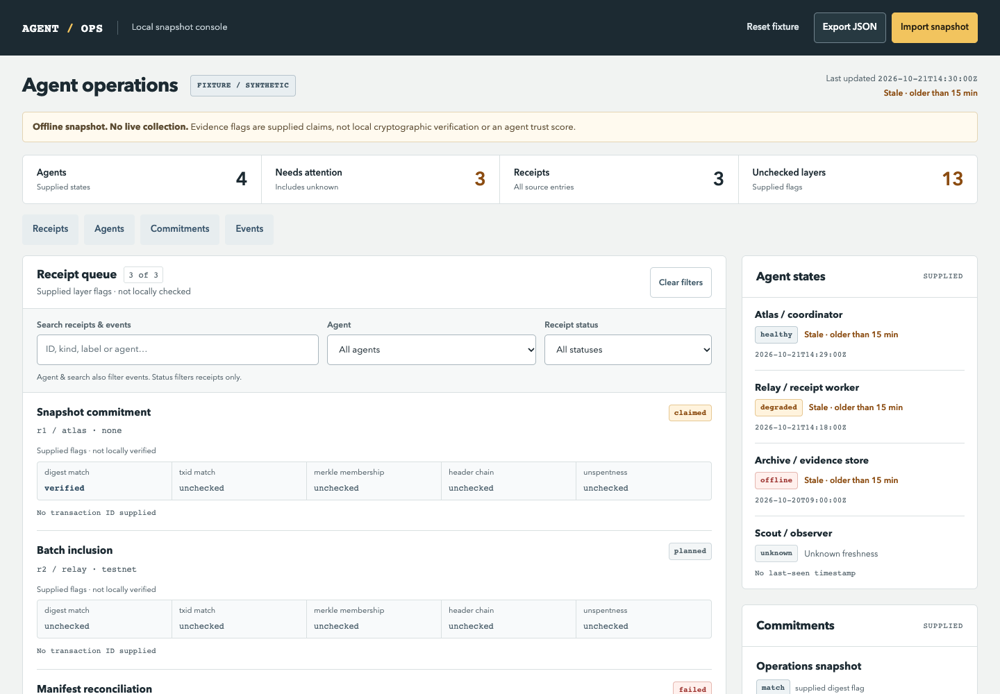
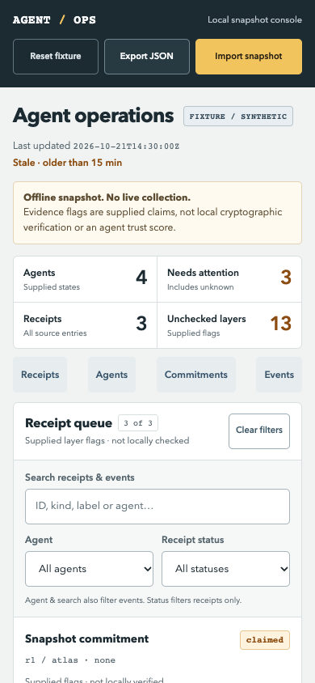

<div align="center">


# BSV Hermes

### One native toolset for inspecting BSV data and creating agent evidence commitments.

**Inspect the bytes. Commit the work. Keep the evidence boundaries visible.**

Offline by default · Six dependency-free default tools · Optional guarded mainnet publication

[Quick start](#quick-start) · [Workflows](#agent-workflows) · [Tools](#what-you-can-do) · [Dashboards](#dashboard-preview) · [BSV resources](#learn-and-build-with-bsv) · [FAQ](#faq) · [Documentation](#documentation)

</div>

> **Release candidate · v0.3.0rc1.** Six tools remain offline by default. The opt-in mainnet group integrates a dedicated wallet, bounded funding observations, exact transaction construction, separately authorized signing/submission and readback receipts. No automatic publication, arbitrary payments or chain-consensus verification. Production OS/custody isolation and any funded canary remain separate operator work. License selection is pending; see [license policy](LICENSE-POLICY.md).

Give your Hermes agent tools to inspect transaction and Script bytes, plan unsigned commitments, and produce versioned receipts for supplied SOUL content and work products. Add instruction, deployment-evidence and batch workflows through optional kits in the same installation.

The default tools process supplied inputs without private-file discovery, home SOUL reads, activity collection or provider contact. Three packaged task skills explain the workflows. Mainnet operations require a separately provisioned dedicated runtime and independently controlled operator authority; see the [mainnet ceremony and trust boundary](docs/MAINNET.md).

## Quick start

### Install into your chosen Hermes profile

You need Python 3.9+ and a compatible Hermes host with native directory-plugin support. Use this source checkout or an extracted source distribution. The wheel is a Python library with packaged skills—not a native plugin installer.

```sh
git clone https://github.com/eclexdex/bsv-hermes.git
cd bsv-hermes
python scripts/install_local.py --profile /absolute/path/to/profile
```

Replace the path with an **existing absolute Hermes profile directory**. The command defaults to a dry-run: it checks the source inventory and hashes, rejects collisions and unsafe links, and writes nothing.

Review the result, then explicitly install:

```sh
python scripts/install_local.py --profile /absolute/path/to/profile --install
```

The installer copies into `<profile>/plugins/bsv-hermes` and reads the installed files back. It does not enable the plugin, change configuration, fetch dependencies or infer your profile. Existing targets are not overwritten. Use a trusted local filesystem without concurrent writers to the target ancestors.

### Review and enable

In a POSIX shell, select the same profile:

```sh
export HERMES_HOME=/absolute/path/to/profile
hermes plugins doctor "$HERMES_HOME/plugins/bsv-hermes"
hermes plugins enable bsv-hermes
```

Restart Hermes or use `/reset` to refresh tools and skills. In PowerShell, set `$env:HERMES_HOME = 'C:\absolute\profile'` before running the Hermes commands; Windows execution has not been certified for this candidate.

This is the tested local-copy route. `hermes plugins install .` is not its equivalent; current Hermes installation commands accept catalog/Git identifiers. A direct Git installation route has not been independently accepted for this repository.

### Ask your agent

```text
Use the BSV tools to plan a commitment for the text "harvest receipt / lot 001".
Show the digest and unsigned script. Explain what the result proves and what
remains unchecked. Do not sign, broadcast or publish anything.
```

Or bring your own approved input:

```text
Inspect this transaction hex without executing scripts or contacting a network.
Summarize the inputs, outputs and txid, and separate structural findings from
anything that would require chain verification.
```

Replace the example with your supplied transaction hex. Never include wallet secrets, private keys or seed phrases.

## Agent workflows

### Review before you anchor

```text
Inspect my supplied transaction and commitment script. Report structural
findings, identify exactly which bytes are committed, and list the checks
that still need a wallet, node or chain-proof verifier. Make no network calls.
```

Start with `bsv_inspect_transaction`, `bsv_inspect_script` and the inspect-evidence skill. A parsed transaction is not necessarily valid, mined or spendable.

### Record a release without exposing its contents

```text
Using only the approved digests and byte counts I supply, create an artifact
receipt for this release. Explain the receipt format and privacy limits.
Do not read other files or publish the receipt.
```

Use `bsv_assurance_artifact`. For supplied SOUL bytes, use `bsv_identity_soul` instead: the formats and domains are intentionally distinct. Keep private content out of tool arguments unless your host and model-provider policies permit it.

### Review deployment evidence

```text
With the assurance kit enabled, review this supplied tool-call evidence chain
and deployment-gate input. Separate failed comparisons, missing evidence and
unchecked claims. Treat the result as advisory, not permission to deploy.
```

This needs the [assurance kit](#optional-kits). The plugin does not collect the evidence, authenticate operator approval or execute the deployment.

## How it works

```text
Approved supplied input
        |
        v
Hermes agent + task skill
        |
        v
Native bsv toolset -> input validation -> offline operation
        |
        v
JSON result + evidence limitations
        |
        v
Agent explains the result; operator decides what happens next
```

The plugin has one native root, one `bsv` toolset and one Python distribution. Six tools register by default. Optional kits add capabilities without requiring separate plugin installations.

All native handlers return JSON strings using a shared envelope:

```json
{"ok": true, "result": {}}
```

Failures use `{"ok":false,"error":{"code":"invalid_input","message":"..."}}`; successful responses may include warnings. **Execution success is not comparison success.** A comparison inside `result` can be false even when `ok` is true. Exact contracts are in [CONTRACT.md](docs/CONTRACT.md).

## What you can do

| Task | Default tool | What it returns |
| --- | --- | --- |
| Discover this installation | `bsv_capabilities` | Actual registered tools and enabled kits |
| Inspect a transaction | `bsv_inspect_transaction` | Bounded legacy transaction structure and txid |
| Read Script bytes | `bsv_inspect_script` | Inert disassembly; no execution |
| Plan a text commitment | `bsv_plan_commitment` | SHA-256 digest and unsigned OP_RETURN script plan |
| Commit supplied SOUL content | `bsv_identity_soul` | Versioned commitment or receipt comparison for exact supplied bytes |
| Make a work-product receipt | `bsv_assurance_artifact` | Digest receipt from supplied digest/byte-count records |

For example, tool arguments for a text plan are `{"text":"hello"}`. A SOUL commitment accepts `{"data_b64":"aGVsbG8=","network":"testnet"}`. These are intentionally different commitment formats; matching text does not make their receipts interchangeable.

The `network` field binds a receipt's declared context. It does not create a network connection or submit a transaction.

### Guided workflows

The installation includes three task skills:

- `bsv-hermes:inspect-evidence` — inspect bytes and distinguish local findings from unchecked claims.
- `bsv-hermes:plan-commitment` — offline planning by default; guarded mainnet workflow only when separately configured and approved.
- `bsv-hermes:audit-workproducts` — work with supplied work-product and deployment evidence.

Discover them with `skills_list`, then load the selected skill with `skill_view`.

## Optional kits

Enable any subset through your chosen profile's native plugin settings:

```yaml
plugins:
  entries:
    bsv-hermes:
      settings:
        enabled_kits: [identity, assurance, integrations]
```

Review configuration changes yourself and restart to apply. The repository never writes this setting automatically. Unknown or duplicate kit names reject registration.

| Kit | Additional tools | Focus |
| --- | --- | --- |
| Identity | `bsv_identity_instructions`, `bsv_identity_posture`, `bsv_identity_release` | Supplied instruction, posture and release commitments |
| Assurance | `bsv_assurance_tool_chain`, `bsv_assurance_deployment_gate`, `bsv_assurance_approval_intent` | Evidence chains and advisory deployment/approval checks |
| Integrations | `bsv_int_batch`, `bsv_int_verify_batch`, `bsv_int_content`, `bsv_int_overlay`, `bsv_int_handoff`, `bsv_int_chain`, `bsv_int_reconcile` | Offline batches, content and handoff/reconciliation workflows |

The three **offline** kits give 19 tools. They do not grant authority. The separate
`mainnet` group adds eight guarded tools: defaults + mainnet = **14 tools**; all
four groups = **27 tools**, still one plugin and one `bsv` toolset. No new advanced
protocol or dashboard packs were merged.

### Opt-in mainnet workflow

| Tool | Actual behavior |
|---|---|
| `bsv_wallet_address` | Dedicated wallet public metadata; no wallet discovery/import |
| `bsv_funding_status` | Bounded mainnet provider GET observations; does not transfer coins |
| `bsv_publish_prepare` | Exact unsigned digest quote from confirmed observed inputs |
| `bsv_publish_sign` | Independent operator grant, shared budget/input locks before real SDK custody |
| `bsv_publish_submit` | Separate exact-txid grant, durable at-most-once dispatch |
| `bsv_publish_status` | Read local workflow and budget state |
| `bsv_publish_receipt` | Readback reconciliation only; never retries submission |
| `bsv_spend_policy_status` | Shared aggregate/session spent, reserved and remaining cap |

The human operator creates the fresh wallet and chooses caps through the operator
CLI, funds its verified address separately, reviews the exact plan, approves
signing, then independently approves the final txid for submission. Native tools
cannot create authority, supply approval JSON, select a different wallet/session,
or release budget. Signed transaction bytes are retained locally, not returned to
model transcripts. A missing real adapter/dependency fails closed.

Use the [complete executable procedure](docs/MAINNET.md). The `mainnet` extra pins
`bsv-sdk==2.4.0` and `cryptography==48.0.0`; use a separate SDK interpreter, not the
Hermes host environment. **Separate Python is not a security sandbox.** Protect
custody and operator administration with an appropriate trusted OS/broker boundary
before funding. The SDK is Open BSV License v4, **not MIT**; reviewed notices and a
platform-specific hash lock are bundled.

This candidate has executed real SDK signing and local HTTP submission/readback
using freshly generated never-funded keys and invented ancestry. It has **not**
spent mainnet funds, submitted to a public broadcaster or enabled a live profile.

## Dashboard preview

The separate OPS dashboard candidate presents supplied agent snapshots and receipt queues. These screenshots use synthetic fixtures, not live fleet data. The dashboard is a development preview and is **not bundled with the v0.2.0 plugin**.

### Desktop operations view



Receipt-first navigation keeps supplied evidence flags, stale timestamps and unknown states visible. The display does not turn supplied claims into cryptographic verification.

### Mobile operations view



The narrow layout brings the receipt queue forward and retains the same offline and unverified-evidence labels. Screenshots illustrate the candidate interface; they are not proof of live collection or chain verification.

## Privacy and evidence

**A digest match is a narrow result—not a trust score.** Parsing, hashing and branch arithmetic do not establish authorship, consent, complete logging, execution truth, PoW, selected-chain membership, SPV, finality or deployment safety. Approval-intent tokens are not authenticated authorization; a caller can mint a matching token.

Supply only approved, nonsecret projections. Native arguments are visible to Hermes and may enter host logs or the model provider's context. Local computation does not make the surrounding agent session private.

Deterministic commitments to low-entropy text permit guessing. Nonces are caller-retained and omitted from native results, but remain visible to the invoking host. Batch proofs are omitted by default; `export_private_proofs: true` returns them for explicit **private local use**. Salting the root does not conceal deterministic proof siblings or prevent correlation. When hiding is required, publish only the final commitment with separate approval—not the proofs.

See [Security](SECURITY.md), [exact formats](docs/CONTRACT.md) and [provenance](PROVENANCE.md).

## FAQ

<details>
<summary><strong>Do I need a wallet or BSV funds?</strong></summary>

Not for the six defaults or three offline kits. The opt-in mainnet workflow requires a new operator-provisioned dedicated wallet, user funding and independent signing/submission approvals. It is never activated by installation.

</details>

<details>
<summary><strong>Does it hash my real SOUL.md automatically?</strong></summary>

No. Supply approved bytes explicitly. The plugin does not discover files or read your agent's private configuration.

</details>

<details>
<summary><strong>Does a matching receipt prove the work happened?</strong></summary>

No. It establishes the particular local comparison described by that tool. It does not authenticate the source, prove execution or verify a blockchain inclusion claim.

</details>

<details>
<summary><strong>Can I use this as an MCP server?</strong></summary>

This version is a Hermes-native directory plugin. An MCP server is not shipped. The wheel exposes the Python library, not automatic native discovery.

</details>

<details>
<summary><strong>How do I update?</strong></summary>

The local installer refuses an existing target and has no force flag. Review the new source and plan a separate removal/migration before reinstalling. There is no automatic updater in this version.

</details>

## Verify and develop

Run the offline tests and verify the source inventory:

```sh
python -m unittest discover -s tests -v
python scripts/update_manifest.py --check
```

Without Hermes host dependencies, one native-host test is explicitly skipped. Without the exact mainnet extra, crypto/workflow tests are separately skipped. Neither skip counts as acceptance. For real Doctor, PluginContext, scoped dispatch and installed-skill checks, use your compatible Hermes host's Python environment:

```sh
python scripts/native_smoke.py .
```

For a source-checkout Hermes environment, ensure the Hermes checkout is importable as well as its dependencies—for example, set `PYTHONPATH=/absolute/path/to/hermes-agent` when invoking that environment's Python. This prevents missing host-module errors such as `hermes_yaml`.

The default native smoke uses temporary homes, exercises the six defaults and
three offline groups, checks three registered skill paths and blocks socket
connections. For the eight added tools, use the same Hermes interpreter plus an
isolated, pinned SDK interpreter:

```sh
python scripts/mainnet_smoke.py . --sdk-python /absolute/dedicated-sdk-venv/bin/python
```

This performs actual registry dispatch through real SDK worker subprocesses,
operator-only approvals, a real loopback HTTP provider and exact txid/raw readback.
The loopback adapters exist only in the test harness; they are not native settings
or synthetic production fallbacks. No live profile or public POST is used.

With trusted setuptools >=77 already installed, build without dependency downloads:

```sh
python -c "from setuptools.build_meta import build_wheel, build_sdist; print(build_wheel('dist')); print(build_sdist('dist'))"
```

Regenerate the source manifest only after reviewed changes. Inventory hashes detect corruption, not author authenticity. Final distribution acceptance should repeat installation and native checks on an extracted archive outside the checkout. See [verification instructions](docs/VERIFICATION.md).

## Learn and build with BSV

Choose the reference that matches your next step. These are external resources, not dependencies or capabilities automatically installed by this plugin.

| Your goal | Start here | What to look for |
| --- | --- | --- |
| Understand transactions, Script and the network | [BSV Skills Center](https://docs.bsvblockchain.org/) | Protocol concepts, technical learning and network architecture |
| Find ecosystem references and real-world applications | [BSV Hub](https://hub.bsvblockchain.org/) | Unified knowledge bases, case studies and links to protocol resources |
| Build an application with a wallet or SDK | [BSV developer guides](https://bsv.writedocs.io/) | Testnet onboarding, wallet integration, payments, storage and application examples |
| Check an interoperability proposal | [BRC specifications](https://bsv.brc.dev/) | Exact data formats, protocol definitions and each proposal's current status |
| Work with the TypeScript SDK | [BSV TypeScript SDK](https://github.com/bsv-blockchain/ts-sdk) | SDK source, installation guidance and application-building primitives |
| Explore implementation repositories | [BSV Blockchain on GitHub](https://github.com/bsv-blockchain) | Source projects and their individual documentation and licenses |

**Suggested path:** inspect supplied bytes locally → prepare a commitment → review the [mainnet trust boundary and operator ceremony](docs/MAINNET.md) before any signing or submission.

The external guides describe features such as wallets, HTTP payments, UHRP and SPV. Linking to them does **not** mean this plugin implements those features. BRCs include historical and evolving material: check directory guidance and normative status rather than assuming every proposal is a current interoperable standard. External code and documents retain their own terms.

## Documentation

- [Mainnet operator ceremony and recovery](docs/MAINNET.md)
- [Result contracts and formats](docs/CONTRACT.md)
- [Verification and packaging](docs/VERIFICATION.md)
- [Security boundaries](SECURITY.md)
- [Source provenance](PROVENANCE.md) and [third-party policy](THIRD_PARTY.md)
- [Contributing](CONTRIBUTING.md)

## License and status

The repository is an experimental engineering candidate, not a certified security product. Public licensing remains pending operator selection; no MIT or other open-source license is implied. Read [LICENSE-POLICY.md](LICENSE-POLICY.md) before redistribution.
